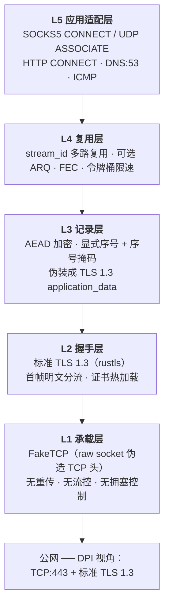
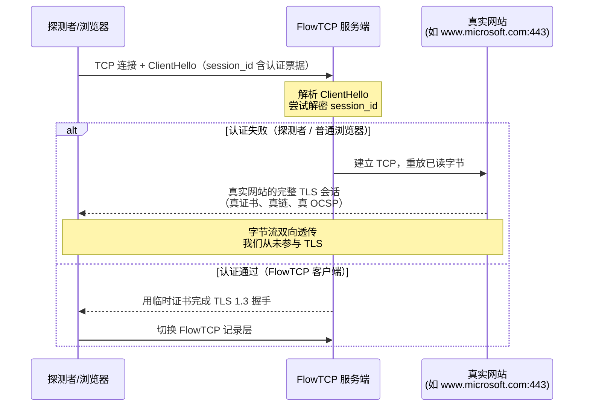

# FlowTCP

> **把 UDP 特性装进 TLS 1.3 的外壳** —— 一套跨平台、高性能的 SOCKS5 代理传输协议

[](https://github.com/flowtcp/flowtcp/actions/workflows/ci.yml)
[](https://www.rust-lang.org/)
[](#许可证)

---

## 一、它解决什么问题

部分 IDC 与运营商会对 **UDP 流量**做 QoS 限速、丢包甚至直接封锁。这导致：

- 游戏、语音、DNS、QUIC（HTTP/3）体验严重下降
- 基于 QUIC 的代理协议（Hysteria、TUIC 等）完全不可用
- 而纯 TCP 代理虽有良好连通性，却**丧失了 UDP 的低延迟、无重传特性**

FlowTCP 的目标：**在公网上看起来是普通的 HTTPS 流量，内层却保留 UDP 的数据报语义。**

| 维度 | 传统 UDP 代理 | 传统 TCP 代理 | **FlowTCP** |
|------|--------------|--------------|------------|
| 网络可见形态 | UDP（易被 QoS） | TCP + TLS | **TCP:443 + TLS 1.3** |
| 数据报语义 | ✅ 保留 | ❌ 变字节流 | ✅ **保留** |
| 队头阻塞 | ❌ 无 | ✅ 有（严重） | ✅ **无** |
| 丢包影响范围 | 仅单个数据报 | 全部后续数据 | **仅单个记录** |
| 可叠加 FEC / 多倍发包 | ✅ | ❌ 不可能 | ✅ **可以** |
| 主动探测抗性 | 取决于协议 | 取决于协议 | **真证书 + 真站点 fallback** |

---

## 二、核心设计

### 2.1 四层架构



### 2.2 关键突破：TLS 的头 + DTLS 的序号

标准 TLS 1.3 **无法容忍丢包**。RFC 9147 §3 明确指出：

> TLS relies on an **implicit** sequence number on records. If a record is not received,
> then the recipient will use the **wrong sequence number** when attempting to remove
> record protection from subsequent records.

即：丢一个包 → 后续所有记录的 AEAD nonce 全错 → 全部解密失败。

FlowTCP 的解法是取两家之长：

```text
 0                   1                   2                   3
 0 1 2 3 4 5 6 7 8 9 0 1 2 3 4 5 6 7 8 9 0 1 2 3 4 5 6 7 8 9 0 1
+---------------+---------------+-------------------------------+
|     0x17      |  0x03 |  0x03 |         length (16)           |   ← 与真 TLS 1.3
+---------------+---------------+-------------------------------+      逐字节一致
|                       masked_seq (64)                         |   ← 借 DTLS 1.3
+---------------------------------------------------------------+      序号掩码
|                  ciphertext (= plaintext + tag)               |
+---------------------------------------------------------------+
```

- **头 5 字节**：`0x17 0x03 0x03` + 长度 —— 与真实 TLS 1.3 `application_data` 记录完全一致
- **序号掩码**：`mask = AES-ECB(sn_key, ciphertext[0..16])[0..8]`
  - 接收端**只依赖密文**即可还原序号，不存在"先有鸡还是先有蛋"的问题
  - 序号在线上不可见，防止 DPI 用它关联同一连接的多条路径
  - 乱序、丢包都只影响单条记录

> **AAD 必须用未掩码的序号**，否则会形成「AAD 依赖密文 → 密文依赖 AAD」的循环，
> 被迫加密两遍。这是实现时最容易踩的坑，已在 `record.rs` 模块文档中详细说明。

### 2.3 抗主动探测：偷网站（REALITY 式）

这是**最重要的设计**。我们不做自己的网站，而是认证失败时把 TCP 字节流
**原样透传**给真实网站：



**为什么这比"自己扮演网站"强**：探测者看到的是真实网站完整无误的 TLS 会话。
我们从未参与 TLS，因此**不可能**在那个连接上露出任何破绽。

**收益**：不需要域名、不需要证书、不需要 ACME、不需要 nginx。

#### 认证载体：ClientHello.session_id

TLS 1.3 的 `session_id` 是 32 字节**内容不受约束**的兼容性字段
（RFC 8446 §4.1.2）。真实 Chrome 也会填它，所以"非空"不异常，
内容看起来就是随机数：

```text
session_id[32] = AEAD(key, nonce=0, aad=client_random,
                      plaintext = ver(1) || ts(4) || short_id(8) || pad(3))
              = 密文(16) + tag(16) = 32 ✓
```

**密钥来源是关键**：复用 ClientHello 里**本来就有**的 X25519 `key_share`，
不需要任何额外字段：

```rust
shared = X25519(reality_priv, client_key_share_pub)   // 服务端
shared = X25519(ephemeral_priv, reality_pub)          // 客户端，同一值
key = HKDF-SHA256(shared, salt = client_random)
```

#### 裁决链路

| 步骤 | 检查 | 失败处置 |
|------|------|---------|
| 1-3 | SNI 在允许列表 / 有 X25519 key_share / session_id 长度正确 | 转发 |
| 4-7 | AEAD 解密成功 / 版本正确 / 时间戳 ±30s / short_id 匹配 | 转发 |
| ✅ | 全通过 | 自行完成 TLS 握手 |

失败原因**只记日志，绝不回给客户端** —— 任何"认证失败"响应都是自曝。

### 2.4 流量整形：AnyTLS 式 padding

内层承载 HTTPS 时会产生 **TLS-in-TLS** 特征（固定尺寸的记录反复出现）。
REALITY 作者明确指出这类特征"已被针对"。

AnyTLS 的解法：按「第几次写入」施加分片 + 填充策略，只整形前 8 个包：

```text
stop=8
0=30-30                 # 第 0 包固定 30 字节
1=100-400               # 随机拆出 100~400
2=500,c,500-1000,...    # c = 若数据已发完则提前结束
```

> 只整形握手阶段：数据阶段整形会严重损害吞吐（大包拆小 = 更多 header 开销）。

## 三、当前状态

| 模块 | 状态 | 说明 |
|------|------|------|
| `flowtcp-proto` 内层帧编解码 | ✅ 完成 | 10 字节帧头、地址编码、MTU 预算 |
| `flowtcp-proto` 记录层 | ✅ 完成 | AEAD + 显式序号 + 掩码 + 重放窗口 |
| `flowtcp-proto` 密钥派生 | ✅ 完成 | TLS exporter → 6 段方向性密钥 |
| `flowtcp-proto` **偷网站认证** | ✅ 完成 | ClientHello 解析 + session_id 票据 + 转发裁决 |
| `flowtcp-proto` **流量整形** | ✅ 完成 | AnyTLS 式 `paddingScheme`（分片 + 填充） |
| `flowtcp-faketcp` 承载层 | ✅ 完成 | TUN + iptables 运行时自动配置（端口可配） |
| `flowtcp-tls` 握手层 | ✅ 完成 | **JA4 指纹实测匹配 Chrome（`8daaf6152771`）** |
| `flowtcp-cli` | ✅ 完成 | `selftest` / `fingerprint` / `info` |
| 测试 | ✅ **115 个全部通过** | 含真实 TCP 互通、TLS 端到端、指纹验证、认证裁决 |
| Docker 构建 | ✅ 完成 | 多阶段 + cargo-chef 缓存 + BoringSSL 工具链 |
| GitHub Actions | ✅ 完成 | fmt / clippy / test / 多架构编译 |
| SOCKS5 / DNS / ICMP 入口 | ⬜ 待开发 | Phase 3 |
| 服务端出口 | ⬜ 待开发 | Phase 3 |
| ARQ + FEC + 限速 | ⬜ 待开发 | Phase 4 |
| 透传转发 + 临时证书 | ⬜ 待开发 | Phase 5 |

---

## 四、快速开始

### 4.1 本地构建

```bash
# 需要 Rust 1.97+
git clone <repo> && cd FlowTCP

# 编译
cargo build --release

# 质量门禁（与 CI 完全一致）
cargo fmt --all -- --check
cargo clippy --workspace --all-targets -- -D warnings
cargo test --workspace
```

### 4.2 运行协议自检

自检**无需网络、无需 root、无需 TUN 设备**，可在任何机器上验证协议栈正确性：

```bash
$ ./target/release/flowtcp selftest
FlowTCP 协议自检 (协议版本 0x01)
exporter 标签: EXPORTER-FlowTCP-v1

  [1/5] 内层帧编解码 .......... 通过 (25 字节)
  [2/5] MTU 1500 预算 ......... payload 上限 1400 字节
  [3/5] TLS exporter 密钥派生 . 通过 (方向隔离已启用)
  [4/5] 记录层伪装 ........... 通过 (头 0x17 0x03 0x03，与真 TLS 1.3 一致)
  [5/5] 乱序+丢包容忍 ........ 通过 (6/8 记录全部正确解密)

全部自检通过。协议栈就绪。
```

第 5 项是本项目的核心能力验证：**8 条记录倒序到达、且故意丢掉 2 条，
剩余 6 条仍全部正确解密** —— 这正是标准 TLS 做不到的事情。

```bash
$ ./target/release/flowtcp info    # 查看协议参数
$ ./target/release/flowtcp --help  # 帮助
```

### 4.3 Docker 构建

```bash
# 完整质量门禁（fmt + clippy + test）
docker build --target ci -t flowtcp-ci .
docker run --rm flowtcp-ci

# 编译产物（本机架构）
docker build --target builder -t flowtcp-builder .
docker run --rm -v "$PWD/dist:/out" flowtcp-builder \
  sh -c 'cp target/release/flowtcp /out/'
```

> **版本要求**：Dockerfile 固定 `rust:1.97`，必须与本地工具链一致。
> 降版本会因依赖使用新版 manifest 特性而报 `failed to parse manifest`。

### 4.4 多架构编译

服务端只需 Linux amd64 + arm64：

```bash
# 一次性启用 QEMU（只需一次）
docker run --privileged --rm tonistiigi/binfmt --install arm64

# arm64 编译（QEMU 模拟，首次约 10~20 分钟）
docker buildx build --platform linux/arm64 --target builder .
```

> **提示**：arm64 在 x86 上用 QEMU 模拟整个 Rust 工具链，首次编译很慢。
> 建议交给 GitHub Actions（`ubuntu-24.04` ARM runner 或 buildx + GHA 缓存），
> 本地只做 amd64 验证。

---

## 五、工程结构

```text
FlowTCP/
├── Cargo.toml                      # workspace 根
├── Dockerfile                      # 多阶段构建（chef / builder / dist / ci）
├── .github/workflows/ci.yml        # fmt → clippy → test → 多架构编译
├── crates/
│   ├── flowtcp-proto/              # 协议核心（纯逻辑，无 IO）
│   │   ├── src/frame.rs            #   内层帧编解码 + 地址 + MTU 预算
│   │   ├── src/record.rs           #   记录层 AEAD + 序号掩码 + 重放窗口
│   │   ├── src/keyderive.rs        #   TLS exporter → 方向性密钥
│   │   └── src/lib.rs              #   常量与再导出
│   └── flowtcp-cli/                # 统一 CLI
│       ├── src/main.rs             #   入口 + selftest
│       └── src/cli.rs              #   子命令解析
├── docs/
│   └── PROTOCOL.md                 # ★ 协议规范（唯一真相源）
├── AGENTS.md                       # 开发约定
├── PROJECT_PLAN.md                 # 架构决策、阶段规划、风险
├── DEVTIPS.md                      # 踩坑记录与铁律
├── CHANGELOG.md                    # 变更日志
└── DEPLOY_CREDENTIALS.md           # 部署凭证（已在 .gitignore 排除）
```

**为什么 `flowtcp-proto` 是纯逻辑无 IO**：

1. 无需 root / TUN / 网络即可单元测试 —— CI 快速且稳定
2. 同一套协议逻辑复用于 Linux / Windows / Android 各平台承载层
3. 密码学与线格式集中一处，便于逐行审计

---

## 六、技术选型与取舍

| 组件 | 选择 | 理由 |
|------|------|------|
| 承载层 | **FakeTCP**（`fake-tcp` crate） | 用真 TCP 必然引入拥塞控制 + HOL，UDP 低延迟全失 |
| 加密 | **AES-128-GCM / ChaCha20-Poly1305** | 单层 AEAD；双层 TLS = 双倍 CPU + TLS-in-TLS 特征 |
| TLS 实现 | **rustls** | 纯 Rust、无 OpenSSL 依赖、支持 `export_keying_material` |
| 序号 | **显式 + XOR 掩码** | 隐式序号遇丢包全链失效；明文序号是强特征 |
| 服务端伪装 | **偷网站（透传）** | 认证失败时把 TCP 字节流原样转发给真实网站，零证书零 nginx |
| 证书 | **ACME DNS-01 优先** | **禁用 TLS-ALPN-01**（需 LE 建真 TCP 到 443，与 FakeTCP 冲突） |

### 已被否决的方案

以下方案经过实测与文档核实后排除，记录在此避免重复讨论：

| 方案 | 否决原因 |
|------|---------|
| QUIC over TCP（quinn-proto） | Nginx 无法按路径反代传输层字节；需关 CC/pacing/PTO；内层强制双层 TLS |
| h2 直连（naiveproxy 式） | 需独占 443，无法挂路径；本质真 TCP |
| WSS + yamux | 本质真 TCP，有 HOL 与拥塞控制，丧失 UDP 特性 |
| GOST `relay+tls` | smux 单窗口 → HOL 无法根治；`probeResist` 对 relay 无效 |
| udp2raw | FakeTCP 无有序流，**无法套 TLS**；单目标；需 iptables + root |
| kcptun / UDPspeeder | 承载在 UDP 上，套 TLS 不可行；UDP 本身被 QoS |
| DTLS 1.3 直接使用 | 密文头格式与 TLS 不同，DPI 可区分 |

---

## 七、平台支持

| 平台 | FakeTCP 承载 | 权限 | 说明 |
|------|-------------|------|------|
| Linux（服务端） | ✅ | `cap_net_admin` + `cap_net_raw` | 主目标 |
| Linux（客户端） | ✅ | 同上 | 主目标 |
| Windows | ⚠️ | 管理员 + WinDivert | 杀软可能告警 |
| Android（root） | ✅ | root | |
| Android（无 root） | ❌ | — | 降级 WSS 承载（牺牲 UDP 特性） |
| macOS / iOS | ❌ | — | 系统限制，暂不支持 |

> FakeTCP 需要构造原始 IP 包，因此无法在无 root 的 Android / 受限的 macOS 上工作。
> 这是技术硬限制，不是实现取舍。

---

## 八、开发路线

| Phase | 目标 | 验收标准 |
|-------|------|---------|
| **Stage 0** | 环境验证 | 确认目标网络 UDP 受限但 TCP:443 正常 |
| **Phase 1** | FakeTCP 打通 | `tcpdump` 看到正常 TCP 外观，UDP 回显可用 |
| **Phase 2** | TLS 握手 + 分流 | ✅ JA4 与 Chrome 一致；4 类首帧分流正确 |
| **Phase 2.5** | 偷网站认证 | ✅ 透传 4 场景 e2e 通过（真浏览器视角无破绽） |
| **Phase 2.6** | ★ 自研 TLS 1.3 客户端 | ✅ 与 BoringSSL 握手成功；`EXPORTER_SECRET` 等 secret 逐字节一致 |
| **Phase 3** | SOCKS5 TCP + UDP | 浏览器 / Telegram / 游戏正常 |
| **Phase 4** | ARQ + FEC + 限速 | 丢包 20% 下游戏可玩、网页可加载 |
| **Phase 5** | 透传转发 + 临时证书 | 浏览器拿到真实网站响应；认证客户端走代理 |
| **Phase 6** | 多平台客户端 | Windows / Android / WSS 降级 |
| **Phase 7** | 产品化 | 多用户、流量统计、订阅管理、GUI |

### 已解决的关键难题

**ClientHello 层认证 + Chrome 级指纹，两者同时成立。**

这是个真正的两难：

- 标准 TLS 库的握手转录由库内部维护，**无法**包含我们改写的 `session_id`
  （改了就 `BAD_DECRYPT`）
- 要控制转录就必须自己实现 TLS 1.3

最终采用**方案 G：自研 TLS 1.3 客户端**：

```text
① 自研 ClientHello 构造器        → 17 个扩展 + GREASE，JA4 = Chrome
② 自研 TLS 1.3 握手              → 转录由我们逐字节控制
③ session_id 自由填入 HMAC 票据  → 服务端据此认证，无需 ECDH
④ 服务端仍用 BoringSSL           → 天然无指纹问题
⑤ exporter 与 BoringSSL 逐字节一致（已用 keylog 全量验证）
```

代价是**必须精确复刻 TLS 1.3 的每一处细节**。实现过程中踩到的坑
（中间盒 fake CCS、Finished 转录时机、exporter 两层派生等）
全部记录在 [`DEVTIPS.md`](DEVTIPS.md) §13。

### 已知待攻关问题

1. FakeTCP 在 Windows（WinDivert）与 Android（root）的稳定性
2. 偷网站目标的可用性（需选 IP 相近、国内可达、无域名跳转的站点）
3. FakeTCP 承载下的乱序到达对 ARQ 窗口设计的影响（Phase 4）

---

## 九、文档索引

| 文档 | 内容 |
|------|------|
| [`docs/PROTOCOL.md`](docs/PROTOCOL.md) | **协议规范**：帧格式、握手、记录层、ARQ、FEC、应用映射 |
| [`PROJECT_PLAN.md`](PROJECT_PLAN.md) | 架构决策清单、阶段规划、风险清单 |
| [`DEVTIPS.md`](DEVTIPS.md) | 开发铁律与踩坑记录（FakeTCP / TLS 指纹 / 偷网站） |
| [`CHANGELOG.md`](CHANGELOG.md) | 变更日志（北京时间） |
| [`AGENTS.md`](AGENTS.md) | 开发约定 |

---

## 十、许可证

双许可，任选其一：

- Apache License 2.0（[LICENSE-APACHE](LICENSE-APACHE)）
- MIT License（[LICENSE-MIT](LICENSE-MIT)）

---

## 十一、免责声明

本项目为网络传输协议研究与工程实践。使用者需自行确保符合所在地区的法律法规
及服务商条款。作者不对任何滥用行为承担责任。
